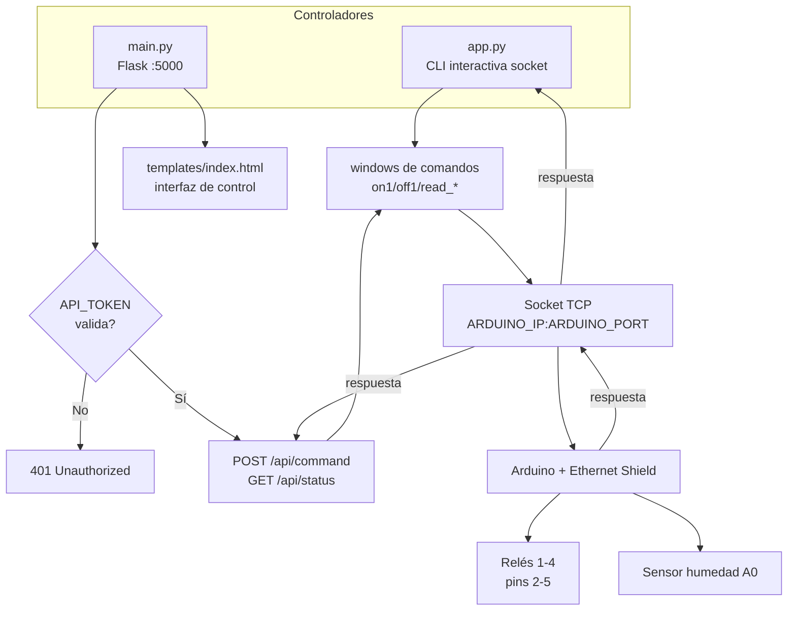

# relay-python-controller

Controlador IoT para manejar relés Arduino a través de Flask y TCP sockets. Incluye interfaz web, API JSON y CLI interactiva.

[](LICENSE)
[](https://python.org)
[](https://flask.palletsprojects.com)

## Contenido

- [Características](#características)
- [Arquitectura](#arquitectura)
- [Stack](#stack)
- [Estructura del repositorio](#estructura-del-repositorio)
- [Instalación](#instalación)
- [Uso](#uso)
- [Configuración](#configuración)
- [Tests / CI](#tests--ci)
- [Roadmap](#roadmap)
- [Licencia](#licencia)

## Características

- Control de hasta 4 relés desde interfaz web (Flask + HTML/JS).
- API JSON con autenticación por token (`X-API-Token`).
- CLI interactiva para enviar comandos TCP directamente.
- Lectura de sensores (humedad, temperatura) desde el Arduino.
- Código Arduino incluido (`garden/garden.ino`) para firmware sobre Ethernet Shield.
- Comunicación bidireccional mediante sockets TCP.

## Arquitectura



## Stack

- Python 3.11+
- Flask 3.0+ (servidor web y API), python-dotenv
- TCP Sockets (comunicación con el Arduino)
- HTML/JS (interfaz web)
- Arduino + Ethernet Shield (firmware C++)

## Estructura del repositorio

```
relay-python-controller/
├── app.py                  # CLI interactiva de comandos TCP
├── main.py                 # Servidor Flask (UI + API JSON autenticada)
├── garden/
│   └── garden.ino          # Firmware Arduino (relés + sensor de humedad)
├── templates/
│   └── index.html          # UI web de control
├── tests/
│   └── test_smoke.py
├── .env.example
├── .github/workflows/ci.yml
├── requirements.txt
├── pyproject.toml
├── LICENSE
└── README.md
```

## Instalación

Requisitos: Python 3.11+, Arduino con shield Ethernet, (opcional) Flask para el servidor web.

```bash
git clone https://github.com/bi0punk/relay-python-controller.git
cd relay-python-controller
pip install -r requirements.txt
```

## Uso

### CLI interactiva

```bash
python app.py
# Ingrese un comando: on1
# Respuesta del Arduino: Relay 1 encendido
# Ingrese un comando: read_temp
```

Comandos disponibles:

| Comando | Acción |
|---|---|
| `on1` / `off1` | Encender/Apagar relé 1 |
| `on2` / `off2` | Encender/Apagar relé 2 |
| `on3` / `off3` | Encender/Apagar relé 3 |
| `read_humidity` | Leer sensor de humedad |
| `read_temp` | Leer sensor de temperatura |
| `read_all` | Leer todos los sensores |

### Servidor web

```bash
python main.py
# Abrir http://127.0.0.1:5000
```

Endpoints de la API (requieren cabecera `X-API-Token`):

| Método | Ruta | Descripción |
|---|---|---|
| `GET` | `/` | Interfaz web de control |
| `POST` | `/api/command` | Enviar un comando al Arduino |
| `GET` | `/api/status` | Leer todos los sensores |


### Firmware Arduino

Subir `garden/garden.ino` al Arduino (configura su IP de forma fija) y ajustar la IP del host en el firmware si el Arduino debe postear lecturas.

## Configuración

Variables de entorno (ver `.env.example`):

| Variable | Default | Descripción |
|---|---|---|
| `ARDUINO_IP` | `192.168.1.177` | IP del Arduino |
| `ARDUINO_PORT` | `80` | Puerto TCP del Arduino |
| `API_TOKEN` | (vacío) | Token requerido para `/api/command` y `/api/status` |

Si `API_TOKEN` está vacío, las rutas de la API rechazan las peticiones con 401.

## Tests / CI

```bash
pip install pytest ruff
pytest -q
ruff check .
```

El workflow `.github/workflows/ci.yml` ejecuta `ruff check` y `pytest` en cada push/PR.

## Roadmap

- [x] CLI interactiva con lista de comandos permitidos
- [x] Servidor Flask con API JSON autenticada por token
- [x] Firmware Arduino para relés y sensor de humedad
- [ ] Soporte para varios Arduinos/dispositivos
- [ ] Autenticación de sesión en la interfaz web
- [ ] Route `/humidity` en el servidor Flask para recibir lecturas del firmware
- [ ] Configuración de IP del Arduino sin editar código (YAML o variable de entorno en firmware)

## Licencia

MIT — ver [LICENSE](LICENSE).